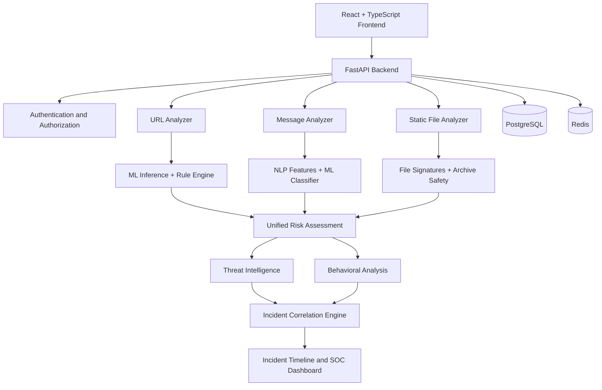

# GuardianX — AI-Powered Cybersecurity & Threat Intelligence Platform

**GuardianX** is a full-stack cybersecurity platform designed to detect, analyze, and correlate potential threats across URLs, text messages, and files. It combines machine learning (ML), natural language processing (NLP), external threat intelligence, explainable risk scoring, and behavioral correlation to identify suspicious activity and organize related events into potential attack chains.

The platform features a Security Operations Center (SOC)-style dashboard for threat monitoring, scan history, analytics, and incident investigation.

## Key Features

* **Multi-Vector Threat Detection:** Analyze suspicious URLs, messages, and files within one platform.
* **ML-Based URL Detection:** Extract URL features and apply machine learning with a rule-based fallback.
* **NLP-Based Message Analysis:** Analyze text using TF-IDF, unigram/bigram features, and social-engineering indicators.
* **Static File Analysis:** Inspect file signatures, extension mismatches, metadata, and archive safety without executing uploaded files.
* **Threat Intelligence Integration:** Integrate VirusTotal URL reputation checks when configured.
* **Explainable Risk Scoring:** Generate risk scores, threat classifications, and reasons supporting detection results.
* **Behavioral Analysis:** Identify repeated suspicious activity, severity escalation, and multi-vector progression.
* **Incident Correlation:** Group potentially related scan events into incidents with risk contributions and investigation timelines.
* **SOC Dashboard:** Monitor threats, review scan history, explore analytics, and investigate incidents.
* **Secure Authentication:** JWT authentication, refresh-token rotation, token-reuse detection, and access-token revocation.
* **API Security:** Rate limiting, input validation, security headers, request-size limits, and user-level data isolation.
* **Production-Oriented Architecture:** PostgreSQL persistence, Redis integration, database migrations, Docker support, and automated tests.

## Architecture



## Technology Stack

| Category                    | Technologies                                           |
| --------------------------- | ------------------------------------------------------ |
| Frontend                    | React, TypeScript, Vite                                |
| UI and Visualization        | Tailwind CSS, Framer Motion, Recharts                  |
| Backend                     | Python, FastAPI                                        |
| Machine Learning            | Scikit-learn, Logistic Regression                      |
| Natural Language Processing | TF-IDF, unigram/bigram features, linguistic indicators |
| Database                    | PostgreSQL, SQLAlchemy                                 |
| Database Migrations         | Alembic                                                |
| Caching and Rate Limiting   | Redis                                                  |
| Authentication              | JWT, bcrypt                                            |
| Threat Intelligence         | VirusTotal API integration                             |
| Testing                     | Pytest                                                 |
| Code Quality                | Ruff, Mypy                                             |
| Deployment                  | Docker, Docker Compose                                 |

## How GuardianX Works

### 1. URL Threat Detection

The URL analyzer validates and normalizes submitted URLs, extracts structural and lexical features, evaluates suspicious indicators, and calculates an explainable risk score.

The detection pipeline supports ML inference and a rule-based fallback when the trained model is unavailable or incompatible.

### 2. Message and Phishing Detection

The message analyzer evaluates text for potential social-engineering and phishing indicators, including:

* Urgency and pressure tactics.
* Credential and sensitive-information requests.
* Financial and payment-related language.
* Impersonation indicators.
* Suspicious links embedded in messages.

Text is represented using TF-IDF with unigram and bigram features and processed by a Logistic Regression classifier alongside heuristic indicators.

### 3. Static File Analysis

The file analyzer inspects uploaded files using static analysis techniques, including:

* File-signature and magic-byte detection.
* Extension and content-type mismatch checks.
* File metadata and SHA-256 hashing.
* Archive structure and safety checks.
* File-size and archive-resource limits.
* Path-traversal safeguards.

Uploaded files are analyzed without being executed.

**Important:** Static inspection is not equivalent to a complete antivirus engine or dynamic malware sandbox.

### 4. Threat Intelligence

GuardianX can integrate with the VirusTotal API to retrieve URL reputation information when a valid API key is configured.

External reputation findings can contribute to the overall risk assessment. Provider failures are isolated so that local analysis can continue where supported.

### 5. Unified Risk Assessment

The risk engine combines relevant detection signals into a normalized score and produces explanatory reasons. It incorporates safeguards against excessively counting overlapping indicators.

The resulting assessment supports consistent presentation across the platform's supported analysis workflows.

### 6. Behavioral Analysis and Incident Correlation

The correlation engine evaluates relationships among scan events using indicators such as:

* Identical URLs and normalized domain information.
* File SHA-256 hashes.
* Sender information.
* Repeated suspicious activity.
* Changes in threat severity.
* Progression across messages, URLs, and files.

Related events can be grouped into incidents with risk contributions, correlation explanations, status tracking, and chronological timelines.

Correlation indicates potentially related activity; it does not independently establish that a system has been compromised.

### 7. SOC Dashboard

The dashboard provides a centralized interface for:

* Reviewing scan activity and risk distributions.
* Inspecting threat classifications and explanations.
* Reviewing suspicious scan records.
* Monitoring incident statuses.
* Exploring correlated events and incident timelines.
* Accessing threat intelligence and security analytics.

## Risk Classification

The URL analyzer uses the following score ranges:

| Risk Score | Classification |
| ---------: | -------------- |
|       0–24 | Low Risk       |
|      25–49 | Medium Risk    |
|      50–74 | High Risk      |
|     75–100 | Critical       |

Risk scores represent automated assessments and should not be interpreted as guarantees that an item is safe or malicious.

## Project Structure

The following is a simplified overview. Adjust directory names to match the actual repository.

```text
GuardianX/
├── backend/
│   ├── app/
│   │   ├── api/
│   │   ├── core/
│   │   ├── db/
│   │   ├── middleware/
│   │   ├── models/
│   │   ├── schemas/
│   │   └── services/
│   ├── alembic/
│   ├── tests/
│   ├── Dockerfile
│   └── requirements.txt
├── frontend/
│   ├── src/
│   ├── public/
│   └── package.json
├── ml/
│   ├── inference/
│   ├── models/
│   └── training/
├── data/
├── docs/
├── scripts/
├── docker/
├── docker-compose.yml
├── .env.example
├── .gitignore
└── README.md
```

## Getting Started

### Prerequisites

Install the following tools before running GuardianX locally:

* Git
* Python compatible with the backend dependencies
* Node.js and npm
* Docker and Docker Compose
* PostgreSQL and Redis, or compatible running services

### 1. Clone the Repository

```bash
git clone <YOUR_GITHUB_REPOSITORY_URL>
cd GuardianX
```

### 2. Configure Environment Variables

Copy the example configuration:

```bash
cp .env.example .env
```

Configure the variables required by your application, including:

* Environment mode.
* PostgreSQL connection URL.
* Redis connection URL.
* JWT signing secret.
* CORS allowed origins.
* Optional VirusTotal API key.
* Threat-intelligence settings.

Use the exact variable names defined in your application's settings.

**Security:** Never commit `.env`, production secrets, database credentials, or API keys to GitHub.

### 3. Start the Application Services

If your Docker Compose configuration defines the backend, PostgreSQL, and Redis services, run:

```bash
docker compose up --build -d
```

Check service status:

```bash
docker compose ps
```

### 4. Apply Database Migrations

Run Alembic migrations against the configured database:

```bash
docker compose exec backend alembic upgrade head
```

Replace `backend` with the actual Compose service name if it differs. If migrations are run automatically by your deployment process, follow that process instead.

### 5. Start the Frontend

For local development:

```bash
cd frontend
npm install
npm run dev
```

The Vite development server commonly runs at:

`http://localhost:5173`

### 6. Access GuardianX

With the default local ports configured:

| Service                   | URL                                  |
| ------------------------- | ------------------------------------ |
| Frontend                  | `http://localhost:5173`              |
| Backend                   | `http://localhost:8000`              |
| Swagger API documentation | `http://localhost:8000/docs`         |
| Liveness endpoint         | `http://localhost:8000/health/live`  |
| Readiness endpoint        | `http://localhost:8000/health/ready` |

Your actual URLs depend on the configuration in your repository.

## API Overview

GuardianX exposes API endpoints for authentication, analysis, scan history, and incident investigation.

The table below summarizes the implemented endpoint structure. Check the running OpenAPI documentation for exact request schemas, authentication requirements, and response formats.

| Functionality          | Method | Endpoint                          |
| ---------------------- | ------ | --------------------------------- |
| Liveness check         | GET    | `/health/live`                    |
| Readiness check        | GET    | `/health/ready`                   |
| User registration      | POST   | `/api/v1/auth/register`           |
| User login             | POST   | `/api/v1/auth/login`              |
| Refresh tokens         | POST   | `/api/v1/auth/refresh`            |
| User logout            | POST   | `/api/v1/auth/logout`             |
| Current user           | GET    | `/api/v1/auth/me`                 |
| URL analysis           | POST   | `/api/v1/analyze/url`             |
| URL scan history       | GET    | `/api/v1/analyze/url/history`     |
| Message analysis       | POST   | `/api/v1/analyze/message`         |
| Message scan history   | GET    | `/api/v1/analyze/message/history` |
| File analysis          | POST   | `/api/v1/analyze/file`            |
| File scan history      | GET    | `/api/v1/analyze/file/history`    |
| List incidents         | GET    | `/api/v1/incidents`               |
| Incident details       | GET    | `/api/v1/incidents/{id}`          |
| Update incident status | PATCH  | `/api/v1/incidents/{id}/status`   |
| Incident timeline      | GET    | `/api/v1/incidents/{id}/timeline` |

## Testing and Code Quality

### Backend Tests

Run the test suite from the configured Python environment:

```bash
pytest
```

### Linting

```bash
ruff check .
```

### Static Type Checking

```bash
mypy .
```

### Frontend Production Build

From the frontend directory:

```bash
npm run build
```

At the M8 milestone, the project reported **677 passing backend tests**, with Ruff and strict Mypy checks clean and the frontend build verified. Re-run all checks against the current codebase before relying on these results.

## Security and Privacy

GuardianX incorporates defensive security controls, including:

* Password hashing and protected authentication flows.
* Refresh-token rotation and token-reuse detection.
* Access-token revocation.
* Rate limiting and request-size restrictions.
* Input validation and security headers.
* User-level authorization and data isolation.
* Safe static file inspection without file execution.
* Bounded archive inspection.
* Separation of submitted content from persisted scan metadata.
* Local indicator normalization without intentional DNS lookups or external network requests.

Production deployment still requires appropriate HTTPS configuration, secure environment variables, restrictive CORS, dependency maintenance, database backups, and deployment-specific security testing.

## Deployment

GuardianX is designed with Docker-based deployment in mind.

A typical deployment consists of:

* **Frontend:** Static hosting for the React/Vite application.
* **Backend:** A Docker-compatible service hosting FastAPI.
* **Database:** PostgreSQL for user, scan, and incident records.
* **Redis:** Rate limiting, access-token revocation, and caching.

Before deployment:

1. Configure production database and Redis connections.
2. Set strong production secrets.
3. Configure the frontend API base URL.
4. Restrict CORS to the deployed frontend origin.
5. Apply Alembic migrations.
6. Verify liveness and readiness endpoints.
7. Test authentication, scanning, file-upload restrictions, and incident correlation.
8. Confirm logs do not expose credentials or sensitive submitted content.

## Limitations

* The URL and message ML models were trained using synthetic datasets and require evaluation against representative real-world data.
* Automated classifications may produce false positives and false negatives.
* Static file inspection does not replace a dedicated antivirus engine or malware sandbox.
* Threat-intelligence coverage depends on provider availability, API limits, and configuration.
* Correlated events do not necessarily represent a confirmed attack.
* Production readiness requires deployment-specific reliability, security, and performance validation.

## Future Improvements

Potential areas for further development include:

* Evaluation against representative, properly licensed threat datasets.
* Improved model calibration and adversarial robustness testing.
* Expanded end-to-end and concurrent-load testing.
* Production monitoring and alerting.
* Automated backup and restore validation.
* Enhanced incident reporting and investigation exports.

## Disclaimer

GuardianX is an educational and defensive cybersecurity project intended to support threat awareness and investigation. Its outputs are probabilistic and should not be the sole basis for security decisions. Analyze only files, messages, URLs, and systems you are authorized to inspect.

## Author

**Krish**
B.Tech — Computer Science Engineering (Data Science)
Manipal University Jaipur

* GitHub: `<YOUR_GITHUB_PROFILE_URL>`
* LinkedIn: `<YOUR_LINKEDIN_PROFILE_URL>`
* Portfolio: `<YOUR_PORTFOLIO_URL>`

---

*GuardianX — Detect threats. Understand risk. Correlate incidents.*
